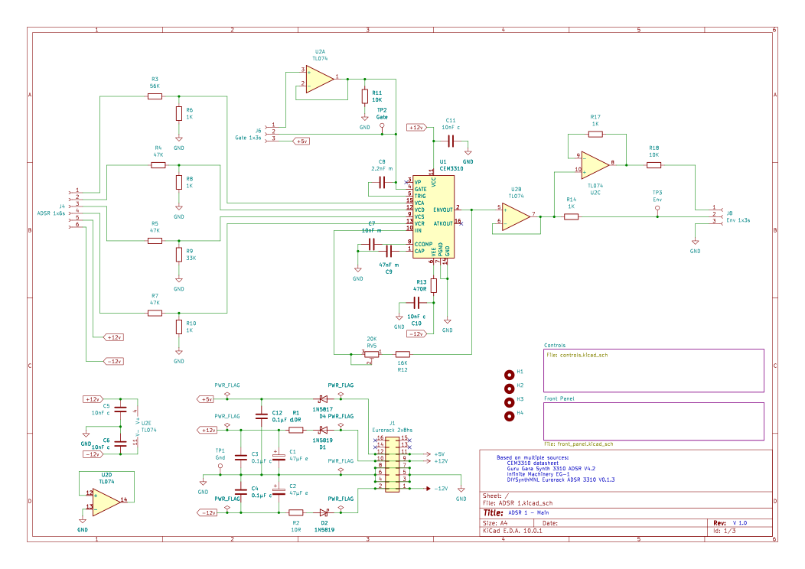

# Envelope Generator

This design is for an ADSR evvelope generator, it is based on the [Guru Gara Synth 3310 ADSR](https://gurugarasynth.com/products/3310-adsr-envelope-generator-eurorack-pcb-and-front-panel-for-diy-synth) AS3310 based envelope generator as this too uses the AS3310 and it's core. The design then adds in an LED indicator inspired by the [DIYSythMNL ADSR 3310](https://diysynthmnl.github.io/p/as3310-voltage-controlled-adsr/) and a gate trigger button of my own design.

## Calibration
The trim pot is used to fine tune the timing of the AS3310 attack phase, in the data sheet they use a 30K resistor but here we have a 16K resistor and a 20k trim pot. This adjusts the timing and is especially noticable on the attack. You probably want an oscilloscope for this although you can get close enough by ear.

> Nigel Daniels 2026
> https://bleepsnbloops.com
> Released under the CERN Open Hardware Licence Version 2 - Strongly Reciprocal
